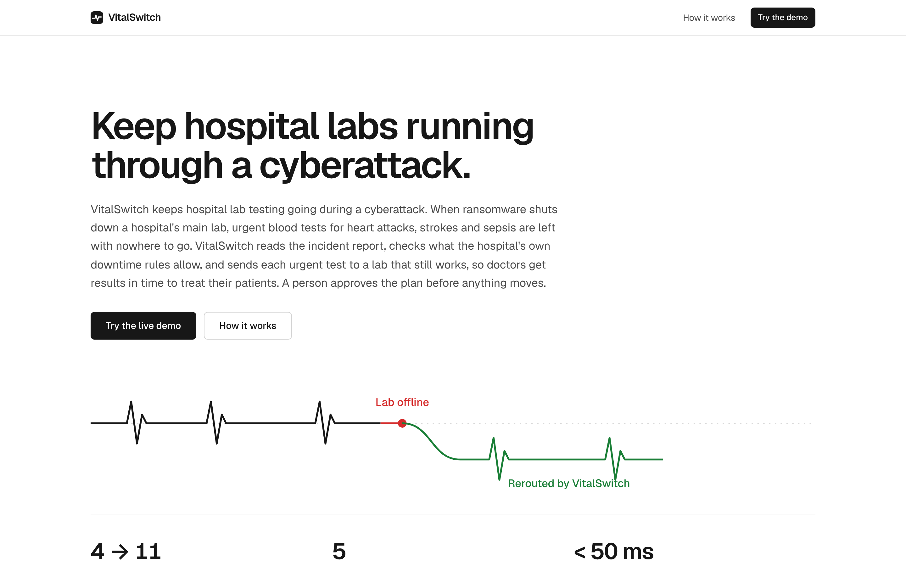
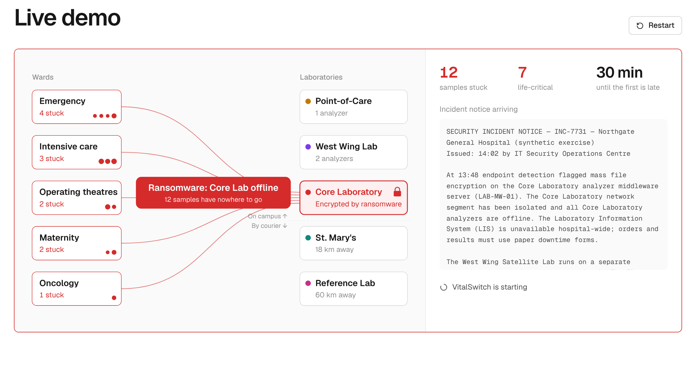
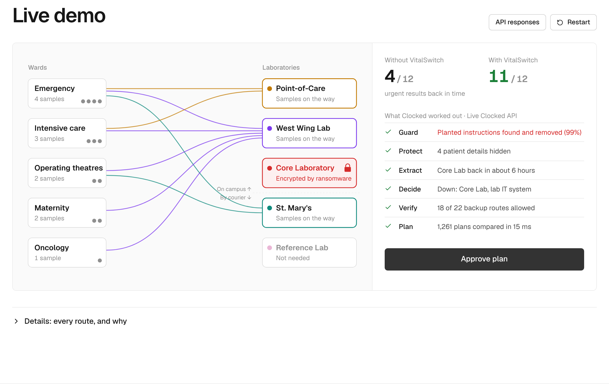
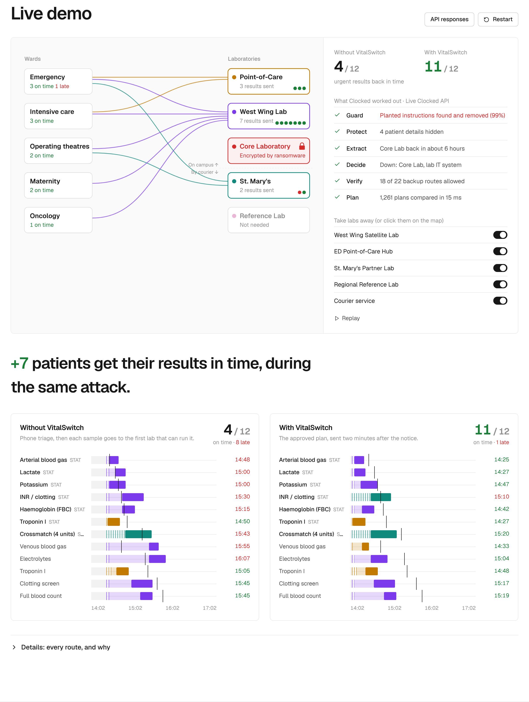
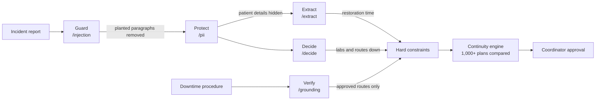

# VitalSwitch

**Keep hospital labs running through a cyberattack.**

When ransomware takes down a hospital's main laboratory, urgent blood tests for heart attacks, strokes and sepsis are left with nowhere to go. VitalSwitch reads the incident report with five Clocked APIs, checks what the hospital's own downtime rules allow, and reroutes every urgent test to a lab that still works. It produces a plan a coordinator can approve in seconds.

**[Try the live app → vitalswitch.vercel.app](https://vitalswitch.vercel.app)**  ·  Every Clocked call is live, and the API key stays on the server.



| | Without VitalSwitch | With VitalSwitch |
|---|---|---|
| Urgent results back on time (default scenario) | 4 of 12 | **11 of 12** |
| Life-critical (STAT) results on time | 1 of 7 | **6 of 7** |
| Time to a verified plan | 25+ min of phone triage | **seconds** |
| Re-plan when another lab fails | start over by hand | **under 50 ms** |

<sub>All figures are computed by the simulation (`npm run test:engine` reproduces them). The hospital, patients, labs and procedures are synthetic.</sub>

---

## Why this matters

AI is making cyberattacks faster, cheaper and easier to scale. Hospitals are already a favourite ransomware target, and when one is hit the damage isn't measured in lost files. It's measured in delayed treatment.

Most security tools focus on stopping the attack. VitalSwitch focuses on **the hours after an attack succeeds**, when the IT team is containing the breach and clinicians still need answers. During a lab outage today, staff fall back on phone calls and paper. Samples go to whichever backup lab comes to mind first, with no view of capacity, deadlines, or what the hospital's downtime procedure actually allows.

VitalSwitch turns that improvisation into a verified, explainable plan.

## How it works

1. **Read the attack.** Clocked screens the incident report for planted instructions, hides patient details, and works out exactly which labs and transport routes are down, and for how long.
2. **Check the rules.** Clocked checks every possible backup route against the hospital's approved downtime procedure. Anything the procedure does not clearly allow is blocked.
3. **Reroute, with sign-off.** A planning engine compares more than a thousand candidate plans in milliseconds and recommends the one that gets the most urgent results back on time. A coordinator approves it before anything moves.

| The attack hits | VitalSwitch recommends a verified plan |
|---|---|
|  |  |

**The payoff**: the same outage and the same twelve tests, replayed side by side. Click any backup lab to take it offline, and VitalSwitch re-plans from scratch.



## How Clocked drives every decision

Clocked is the decision layer of VitalSwitch, not a feature on the side. Five endpoints run in a fixed pipeline, and each output changes what the planning engine is allowed to do.



| Endpoint | What VitalSwitch sends | How the answer changes the app |
|---|---|---|
| **Guard** `/injection` | The incident report, treated as untrusted content, with a security context for a lab-routing assistant | Every paragraph containing flagged evidence is **removed before any other endpoint reads the report**. In the *Poisoned bulletin* scenario, a hidden paragraph tries to mark two working labs offline and send samples to a fake lab. Guard flags it at 99%, and the plan is protected. |
| **Protect** `/pii` | The cleaned report. Entities: `person`, `phone`, and a custom `medical_record_number`. Mode: `replace` | Only the anonymized text flows downstream, so patient identifiers never leave the intake step. |
| **Extract** `/extract` | Fields for incident ID, issue time, restoration estimate, affected systems (as a list) and containment action | "approximately 6 hours" becomes 360 minutes. That sets when the main lab returns for any sample with no approved backup. |
| **Decide** `/decide` | A `multiselect` over eight criteria (five labs, courier, pneumatic tube, lab IT system) plus a severity `score` | Selected labels switch labs off, cut courier routes, slow transport when the tube is down and add paperwork time when lab IT is down. Probabilities between 0.25 and 0.75 are **flagged for human review**. |
| **Verify** `/grounding` | The procedure as the source document, plus 22 explicit claims such as "St. Mary's Partner Lab is approved to perform crossmatch testing" | Builds the approval table. Only *supported* claims become legal routes; contradicted and not-stated ones are blocked (**fails closed**). The West Wing lab can physically run troponin, but the procedure forbids it, so the plan never sends troponin there. Edit the procedure and the plan changes. |

### Built to be trusted

- **Human in the loop.** VitalSwitch only recommends. Nothing moves until a coordinator approves.
- **Explainable.** For every sample, the app shows which labs were ruled out and exactly why: offline, not approved by the procedure, too slow, or kept free for a more urgent test.
- **Uncertainty is visible.** Borderline Decide answers are flagged rather than silently trusted. A missing restoration estimate falls back to 6 hours and is labelled as assumed.
- **Failures are handled.** Each call carries an `Idempotency-Key` and is retried a limited number of times. If a call still fails, that step falls back to a clearly labelled offline stand-in (`lib/emulator.ts`), never a silent fake.
- **Auditable.** The **API responses** panel shows the exact Clocked JSON behind each run.
- **Secure by design.** The API key lives only on the server (`app/api/clocked/[endpoint]`), and patient data is anonymized before analysis.

## The continuity engine

`lib/engine.ts` is a deterministic planner. The AI interprets the text; the routing decision is made by code you can inspect.

- **Simulation:** each lab is modelled with parallel analyzers, a processing time per test, and transport by tube, porter, hand delivery or courier. Paperwork time is added when the lab IT system is down. Queues serve the most urgent test first.
- **Search:** a greedy seed ordered by urgency, then local search (moving and swapping assignments) with seeded restarts. The same inputs always give the same plan. It optimizes, in order: priority-weighted on-time results, then lateness, then courier use.
- **A fair baseline:** "Without VitalSwitch" is a realistic manual response, not a strawman. Staff spend 25 minutes coordinating by phone, then each sample goes to the first approved lab that can run it, first come first served. It uses the same Clocked-derived constraints.

| Scenario | What happens | On time, without → with |
|---|---|---|
| Core Lab ransomware | Main lab encrypted, backups intact | 4 → 11 |
| Spreading outage | West Wing lab and pneumatic tube also go down | 4 → 9 |
| Poisoned bulletin | Attacker hides routing instructions; Guard removes them | 4 → 11 |
| Core Lab + St. Mary's down | No approved backup remains for crossmatch | 4 → 11 (crossmatch waits) |
| Core Lab + Point-of-Care down | Fewer fast bedside analyzers | 3 → 10 |

## Run it yourself

```bash
git clone https://github.com/Shiv-aurora/CLOCKED-BUILD-CHALLENGE.git
cd CLOCKED-BUILD-CHALLENGE
npm install
cp .env.example .env.local   # set CLOCKED_API_KEY (get one at clocked.rezolve.ai/account)
npm run dev                  # http://localhost:3000
```

Without a key, the app still runs end to end on the labelled offline stand-in.

| Command | What it does |
|---|---|
| `npm run test:engine` | Prints the plans and on-time counts for several outage conditions, with no API calls |
| `npm run record` | Records real Clocked responses for the built-in scenarios (needs the app running with a key) |
| `npm run build:artifact` | Bundles a self-contained, single-file demo that replays the recorded live responses, useful when the live API is slow |

## Project structure

```
app/page.tsx                    landing page: nav, hero, how it works, demo
app/api/clocked/[endpoint]      server proxy to Clocked: key stays server-side, retries, fallback
components/Demo.tsx             demo flow, guided tour, approval, try-to-break-it controls
components/HospitalMap.tsx      animated ward-to-lab diagram
components/Landing.tsx          hero and animated how-it-works panels
components/Gantt.tsx            side-by-side outcome timelines
components/Pipeline.tsx         per-endpoint detail view
lib/clocked.ts                  request builders and interpreters (Clocked answers → constraints)
lib/engine.ts                   simulation, optimizer, baseline
lib/scenario.ts                 synthetic hospital: labs, wards, 12 tests, scenarios, procedure
lib/emulator.ts                 offline stand-in, used only without a key or after a failed call
lib/recorded.json               recorded live responses for the static build
```

**Stack:** Next.js 15, React 19, Tailwind CSS on Vercel's Geist design system, Framer Motion, driver.js for the guided tour. The planning engine runs in the browser, so re-planning is instant. There is no database.

## Limits

- **Synthetic data only.** The hospital, patients, timings and procedures are fictional, and results are simulation outputs, not clinical claims.
- **Clocked interprets text.** Clinical priorities, deadlines, lab menus and capacities come from the scenario data. Which routes are allowed comes only from the approved procedure.
- **Recommendation, not automation.** Every plan needs human approval, and VitalSwitch never touches real infrastructure.
- **Built for desktop screens.**

Built for the Clocked Build Challenge 2026.
